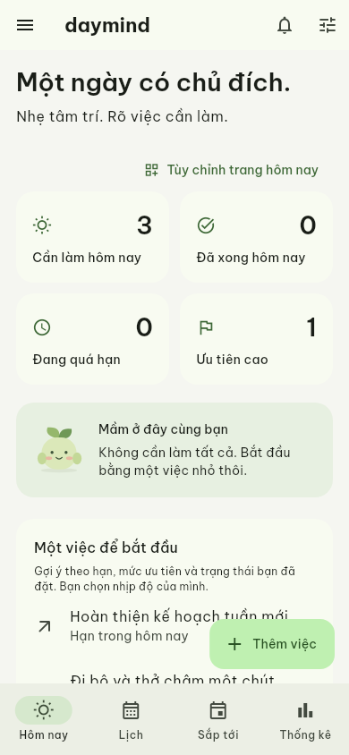
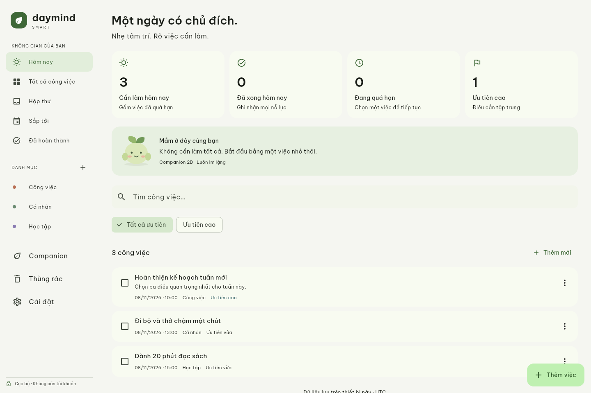
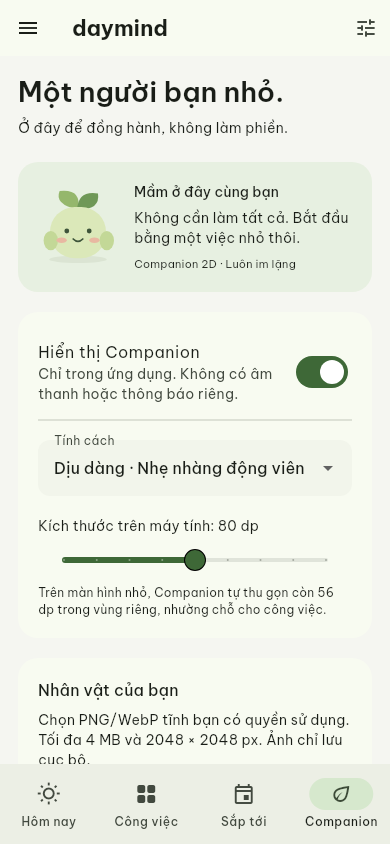
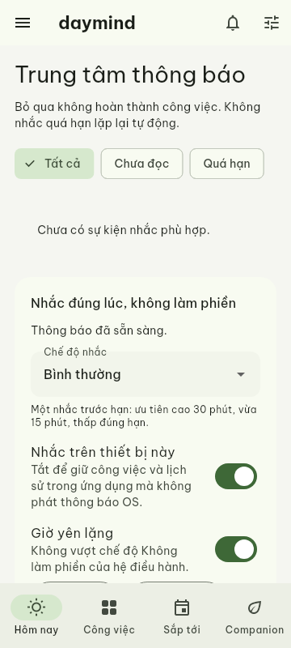
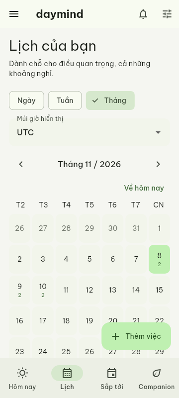
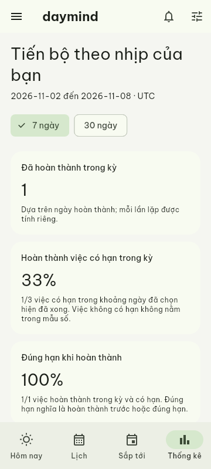

# DayMind SMART — Android & Windows

Ứng dụng Flutter native cho **điện thoại Android ARM64** và **Windows 10 (1809 trở lên)/11 x64**. Không phải vỏ WebView của website. Có quản lý công việc cục bộ, Reminder Engine, lịch/lặp lại, trợ lý/thống kê, tài khoản/đồng bộ Firebase Emulator và Companion tùy chỉnh. Giai đoạn0–8 đã qua cổng tự động (8 dùng nhánh không Live2D); preview0.7.0 đang kiểm giai đoạn9. Dùng được không tài khoản. [Tiến độ từng giai đoạn](docs/PHASE_STATUS.md) ghi rõ phần chưa hoàn thành.

## Đã triển khai

- UI tiếng Việt do DayMind thiết kế: nền dịu, xanh lá trầm, font Be Vietnam Pro. Điện thoại dùng điều hướng dưới; desktop có sidebar; sáng/tối/theo hệ thống.
- Công việc: tạo/sửa, mô tả, 3 mức ưu tiên, 4 trạng thái, danh mục, Inbox, tìm kiếm, quá hạn, Sắp tới, xóa mềm/khôi phục. Hạn không bắt buộc; lịch bắt đầu/kết thúc tách riêng.
- Drift/SQLite có transaction và migration v1/2→v3; revision chặn sửa/xóa từ biểu mẫu cũ. Mở lại app vẫn có dữ liệu.
- Companion **Mầm** là nhân vật gốc, mặc định im lặng; 3 tính cách, lời thoại trong app có cooldown, bật/tắt, kích thước tùy chỉnh. Companion nằm trong vùng riêng, không nổi trên các nút hay biểu mẫu.
- Nhập/thư viện/chọn/xóa PNG/WebP, GIF động hoặc ZIP sprite DayMind. Preflight giới hạn trước codec, checksum/provenance/quyền sử dụng, preview/hủy, cài nguyên tử; giữ nguồn nguyên byte. Thư viện32MiB/128 mục, atlas128px/khung, tối đa120 khung/2048×1024, cadence≤12fps; ngừng/giải phóng atlas khi bị che, cuộn ra ngoài, background hoặc thu khay. Chế độ ít tài nguyên dùng ảnh tĩnh. Xem [định dạng gói](docs/CHARACTER_PACKAGE.md).
- Companion nổi tùy chọn trên Windows, mặc định tắt: cùng tiến trình, không thêm Flutter engine/scheduler; kéo/đổi kích thước, phục hồi vị trí, topmost/click-through tường minh. Tôn trọng giờ yên lặng, fullscreen và trạng thái thông báo OS. Live2D giữ khóa, không bundle SDK/model; [đánh giá kỹ thuật/giấy phép](docs/LIVE2D_GATE.md), không coi ảnh PNG là model Live2D.
- Nhắc việc: một nhắc theo ưu tiên hoặc tối đa 8 mốc tự đặt; xem giờ hiệu lực, giờ yên lặng, gộp, snooze, dismiss, hủy lịch cũ khi sửa/hoàn thành. Trung tâm thông báo có tất cả/chưa đọc/quá hạn. Không xin quyền tự động. Android có receiver và lịch inexact có guard; Windows đóng cửa sổ thu vào khay theo lựa chọn của người dùng để tiếp tục nhắc, có Mở/Thoát hẳn; phần native khay đã qua kiểm thử CI. Không tự khởi động cùng Windows.
- Lịch ngày/tuần/tháng với múi giờ hiển thị; daily/weekly/monthly, khoảng lặp, thứ, số lần/ngày kết thúc, chọn rõ bỏ qua hay dùng cuối tháng thiếu ngày. Sửa một/từ lần này/toàn chuỗi, giữ lịch sử và ngoại lệ.
- Trợ lý hằng ngày: tối đa ba gợi ý có lý do, không lặp nhiều lần của cùng chuỗi; tùy chỉnh các thẻ trang Hôm nay. Thống kê 7/30 ngày dùng ngày hoàn thành thật, hiển thị mẫu số và loại việc hủy/thùng rác.
- Bản tóm tắt **mặc định tắt**, giờ gợi ý 07:00; một bản mỗi ngày địa phương khi bật. Đọc số liệu mới khi phát, không có nút hoàn thành/hoãn công việc. Đổi giờ/quyền không phát lại bản đã xử lý. Phần này đã đạt CI Android/Windows ở checkpoint giai đoạn 4.
- Tài khoản/đồng bộ tùy chọn qua Firebase Emulator: kho SQLite và thư viện riêng theo tài khoản; phiên đăng nhập được mã hóa bằng Android Keystore hoặc Windows DPAPI. Sao chép dữ liệu cục bộ cần chọn tường minh. Outbox bền vững, retry, CAS và giao diện giữ cả hai bản xung đột; đồng bộ chuỗi/cấu hình nhắc theo nhóm để chặn nhắc trùng.
- Chọn một thiết bị nhận nhắc chính khi online; thiết bị chính cũ mất mạng có thể còn báo theo lịch đã lưu. Đăng xuất giữ thay đổi chưa gửi trong kho riêng, trở về dữ liệu cục bộ. Xóa tài khoản cần nhập lại mật khẩu, giữ dấu UID đã xóa để chặn thiết bị cũ tải lại. Không đồng bộ ảnh nhân vật hoặc lịch sử thông báo.
- Android tắt automatic app backup. Chưa cấu hình Firebase production; xem [cách chạy Emulator](firebase/README.md). Giai đoạn 5 đã qua CI Android/Windows với 121 Flutter tests, 25 receiver cases và luồng tài khoản thật trên Emulator.

## Chạy và build

SDK kiểm chứng: Flutter **3.47.9**, Dart **3.13.7**; Flutter commit `c197ca5199e9ee5661e865596c9c07294dfab51c`. Giữ `pubspec.lock`. Cần **JDK 21 đầy đủ**, Android SDK/NDK và Android licenses để build APK. Windows cần Visual Studio Desktop development with C++ và Windows SDK.

Chạy trong thư mục này:

```sh
flutter pub get --enforce-lockfile
python tool/precache_sqlite.py  # Khi đường download GitHub release bị HTTP504
flutter analyze
flutter test
flutter run -d <device-id>
flutter build apk --debug --target-platform android-arm64
```

Trên Windows:

```powershell
flutter build windows --release
flutter test integration_test/app_smoke_test.dart -d windows
```

`.github/workflows/native-build.yml` build/test trên Linux và Windows, xuất APK ARM64, portable Windows kèm VC++ runtime và bộ cài Inno Setup. Bản0.6.0 đã qua cổng tại [Actions42757179906](https://github.com/Duckhanh149/DayMind-Smart/actions/runs/42757179906); tải artifact rồi giải nén. Source0.6.1 thay đổi phải qua CI mới trước nghiệm thu. [PR #1](https://github.com/Duckhanh149/DayMind-Smart/pull/1) vẫn mở, không tự merge hoặc xuất bản release. Xem [BUILD_STATUS](docs/BUILD_STATUS.md) và hashes gói ở docs/qa/PHASE7_PACKAGES.json. Build thành công không thay thế kiểm thử thiết bị thật.

APK preview trong Actions được build tối ưu ARM64 nhưng vẫn ký bằng khóa phát triển; lệnh debug bên trên dành cho phát triển. Bộ cài Windows chưa ký mã phát hành. Cần kiểm chuỗi ký trước nâng cấp; không xóa bản cũ/dữ liệu chỉ để cài đè bản có chứng chỉ khác. Chưa có bản iPhone/iOS, Windows ARM64, Play Store hoặc Microsoft Store. Không cần quyền báo thức chính xác, overlay hoặc chạy lúc khởi động. Quyền thông báo Android chỉ hỏi khi bạn chọn trong cài đặt; từ chối vẫn quản lý công việc bình thường.

## UI đã render bằng Flutter test

Đây là ảnh renderer Flutter headless, không phải screenshot thiết bị Android hoặc Windows thật. Dữ liệu trong ảnh chỉ là fixture của kiểm thử, không được tạo tự động khi người dùng mở app.








## Kiểm chứng và phạm vi còn lại

Giai đoạn0–7 đạt cổng tự động, sourcee993033 / Native42757179906: Android199 Flutter tests/25 receiver, cold-process/digest, Keystore, tài khoản/thư viện thật; Windows197+2 skip do quyền symlink, DPAPI, policy12/component94/Win32 probes/khay/installer. Emulator42752885523 đạt16 ca+7 AOT với lib/backend/package cây giống sourcee993033. Bộ kiểm thử hiện tại bổ sung ca cooldown không làm mất lời nhắc và replay clip cùng biểu cảm; kết quả mới ghi ở [checkpoint](docs/WORK_CHECKPOINT.md).

Giai đoạn8 giữ Live2D tắt theo fallback của đặc tả, duy trì contract renderer Dart và chặn nhập model, chưa tuyên bố SDK/model được cấp phép hoặc render thật. Giai đoạn9 có backup/restore mật khẩu/atomic journal và UI, migration guards, mutex Windows và diagnostics/consent. Source0.7.0 còn cổng native/package/signing/upgrade/phần cứng; chưa hoàn tất dự án. Xem [sao lưu](docs/BACKUP_FORMAT.md), [quyền riêng tư](docs/PRIVACY.vi.md), [ký/phát hành](docs/PRODUCTION_SIGNING.md). Website và kho native hiện tách dữ liệu.

Cổng nghiệm thu Android thiết bị thật, Windows 10/11 thực tế và thông báo OEM/Doze/reboot thật vẫn phải xác minh; không tuyên bố đã đạt chỉ từ widget tests hoặc compilation. Trạng thái build cụ thể xem `docs/BUILD_STATUS.md` và kết quả Actions. Các giai đoạn tính năng tiếp theo giữ theo master spec, không đánh dấu toàn bộ dự án đã hoàn tất.
